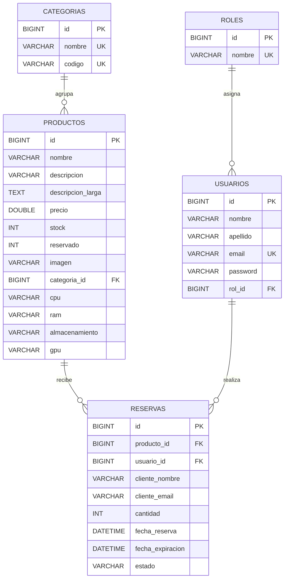

# Modelo Entidad-Relación - Korvia Avance 3

## Diagrama



## Relaciones y cardinalidad

| Relación | Cardinalidad | Implementación JPA | Regla de negocio |
|---|---|---|---|
| `roles` → `usuarios` | 1 a muchos | `Usuario.rol` con `@ManyToOne` | Todo usuario tiene un rol (`ADMIN` o `CLIENTE`). |
| `categorias` → `productos` | 1 a muchos | `Producto.categoria` con `@ManyToOne` | Un producto pertenece a una sola categoría. |
| `productos` → `reservas` | 1 a muchos | `Reserva.producto` con `@ManyToOne` | Una reserva siempre apunta a un producto existente. |
| `usuarios` → `reservas` | 1 a muchos, opcional | `Reserva.usuario` con `@ManyToOne` nullable | Si el cliente no inició sesión, la reserva queda con `usuario_id = NULL`, pero conserva nombre y correo. |

## Decisiones de diseño

1. **Cinco tablas mínimas**: `roles`, `usuarios`, `categorias`, `productos` y `reservas`. Las boletas y cotizaciones siguen en memoria en este avance para no ampliar el alcance.
2. **Claves foráneas reales**: MySQL garantiza la integridad referencial. No se permite borrar una categoría con productos ni un producto con reservas.
3. **`reservado` como contador**: `productos.stock` es el stock físico total; `productos.reservado` son las unidades comprometidas en reservas activas. La disponibilidad se calcula con `stock - reservado`, no se almacena para evitar datos duplicados.
4. **`usuario_id` opcional**: una reserva puede crearse desde el catálogo sin iniciar sesión. Si hay sesión, se vincula al usuario; si no, se usan los datos ingresados en el formulario.
5. **Fechas en la base**: `fecha_reserva` y `fecha_expiracion` permiten que las reservas sobrevivan a un reinicio de la aplicación. El estado (`ACTIVA`, `EXPIRADA`, `CANCELADA`) se actualiza en el servicio.
6. **Consultas DTO**: los reportes usan `JOIN` y proyecciones (`CategoriaConteoDTO`, `ProductoReporteDTO`, `ReservaDetalleDTO`) para no exponer entidades JPA en las vistas.

## Script SQL

El DDL completo y los datos iniciales están en:

```text
database/korvia.sql
```

La aplicación también puede crear las tablas con `spring.jpa.hibernate.ddl-auto=update` y cargar los datos con `DataInitializer`. El script es idempotente para roles, categorías, usuarios y productos: no duplica registros si ya existen.
